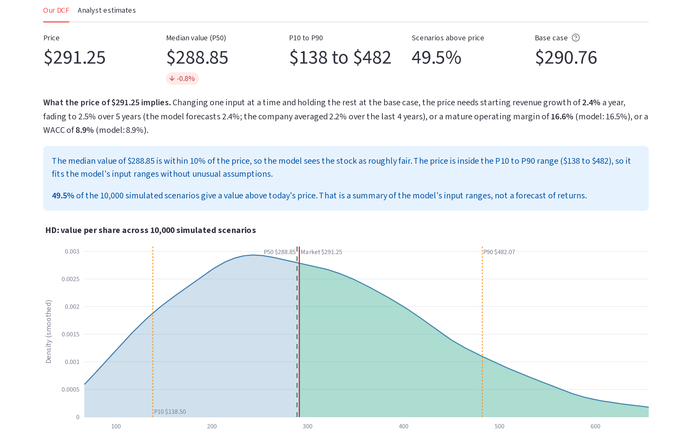

# Monte Carlo DCF

A discounted cash flow model that values a company 10,000 times instead of once.
Type in a ticker and it returns the range of values per share, how many
scenarios come out above today's price, and the revenue growth the price implies.

**Live app:** https://hugh-dcf-calculator.streamlit.app/



## What it does

- **Data.** Pulls the company's accounts from SEC EDGAR (10-K and 10-Q), with
  Financial Modeling Prep and Yahoo Finance as second and third sources. Every
  input shows which source it came from and why.
- **Forecast.** Revenue growth and operating margins are pulled toward what
  similar US companies actually went on to achieve, using a regression fitted on
  about 16,000 company-years of SEC filings (`scripts/estimate_base_rates.py`).
- **DCF.** Free cash flow to the firm, discounted to today with a stub period and
  mid-year timing, a terminal value at 1.5% to 3.5% growth, and a WACC built
  from CAPM and a synthetic credit rating. Foreign companies are valued in their
  own currency at a local bond yield and converted at spot.
- **Monte Carlo.** Growth, margin, terminal growth, WACC and CapEx are drawn
  from PERT distributions tied together with estimated correlations. Real
  disagreement between data sources widens the ranges; definition differences
  (such as whether leases count as debt) don't.
- **Checks.** Banks and insurers are refused, values far from the price are
  flagged, and a reverse DCF shows the growth, margin or WACC the price needs.

## How well does it do?

- **Against analysts (100 stocks):** the price falls inside the model's P10 to
  P90 range for 60% of stocks. The model is usually more conservative than
  analyst price targets, by design. See `dcf/data/analyst_benchmark.csv`.
- **Backtest (2015 to 2020, US small caps, delisted companies included):**
  portfolios picked by the DCF did at least as well as ones picked by P/E, P/S
  or P/B, but the differences were not statistically significant. The full
  write-up is in the app's Research tab (`research/valuationcompare_S22/`).

## Run it

```bash
python -m venv venv && venv/bin/pip install -r requirements.txt
cp .env.example .env              # add FMP_API_KEY and FRED_API_KEY (both free)
venv/bin/streamlit run dcf/portfolio/web.py
venv/bin/python dcf/run_dcf.py HD # base case in the terminal
venv/bin/pytest                   # 63 offline tests
```

## Layout

| Path | What's there |
|---|---|
| `dcf/valuation/` | The model: data, filings, reconciliation, priors, DCF, WACC, Monte Carlo, checks |
| `dcf/portfolio/` | The Streamlit app (`web.py` and the page sections in `app/`) |
| `dcf/tests/` | Unit tests on synthetic companies, run by GitHub Actions on every push |
| `scripts/` | Base-rate fitting, the 100-stock benchmark and weekly price tracking |
| `research/valuationcompare_S22/` | The backtest against P/E, P/S and P/B |

## Limits

The forecast comes from each company's own history, so it misjudges companies
about to change. The equity risk premium (4.5%) and the credit-spread table are
fixed assumptions. Pre-profit companies can't be valued with a DCF and get a
"not applicable" message instead.

Built with Claude Code.
